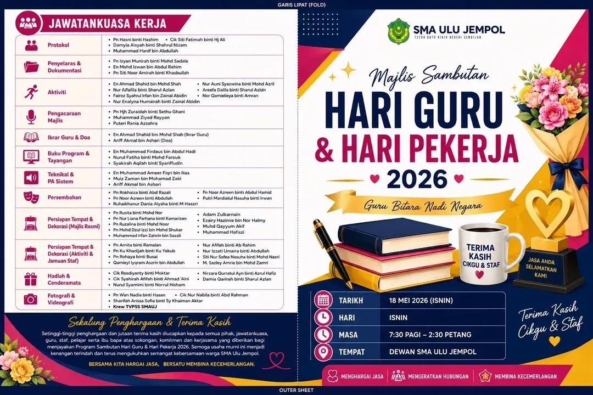
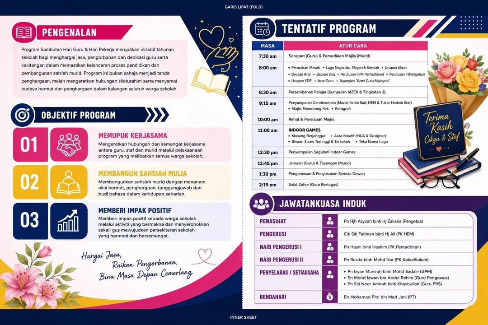

# Buku Program AI

Pakej prompt Bahasa Melayu untuk menghasilkan **buku program A4 landskap lipat dua** menggunakan perbualan ChatGPT masing-masing.

**Bukan aplikasi, bukan bot, bukan automasi pelayar dan bukan Custom GPT yang telah diterbitkan.** Tiada Python, API key atau pemasangan diperlukan untuk menggunakannya. SKILL.md disediakan untuk ejen yang membaca format itu; pengguna ChatGPT biasa menggunakan fail prompt.

## Guna melalui pautan repo (percubaan)

Tampal mesej ini dalam ChatGPT anda:

> Tolong buat buku program menggunakan panduan di https://github.com/firdaushadi442/buku-program-ai . Baca arahan permulaan dalam README dan keseluruhan PROMPT-BUKU-PROGRAM.txt. Cuba teliti kedua-dua pautan contoh yang diberikan dahulu, kemudian minta tema dan maklumat saya. Jangan jana reka bentuk sehingga kandungan disahkan. Hasilkan helaian luar dahulu, tunggu kelulusan, kemudian helaian dalam.

### Arahan permulaan untuk AI

1. Baca [prompt penuh](PROMPT-BUKU-PROGRAM.txt). Jika halaman fail tidak dapat dibaca, cuba [versi teks mentah](https://raw.githubusercontent.com/firdaushadi442/buku-program-ai/main/PROMPT-BUKU-PROGRAM.txt). Jangan sekadar meringkaskan repo; jalankan aliran bantu pengguna membuat buku program.
2. Cuba lihat kedua-dua imej contoh dalam repo di bawah, termasuk pautan imej terus jika halaman GitHub tidak memaparkannya. Jangan dakwa imej telah menjadi lampiran chat secara automatik. Rujuk imej dalam GitHub sahaja; jangan cari contoh melalui Google Drive.
3. Jika benar-benar dapat melihatnya, ringkaskan gaya dan susunan panel dengan pendek. Jangan salin nama, logo, tarikh atau kandungan acara contoh.
4. Jika tidak dapat melihat imej (termasuk jika hanya tajuk fail dapat dibaca), nyatakan hadnya dan minta pengguna muat naik contoh atau memilih untuk meneruskan tanpa contoh. Jangan reka penerangan.
5. Selepas contoh diteliti atau pengguna bersetuju tanpa contoh, tawarkan tema. Minta maklumat yang belum lengkap, semak kandungan, kemudian tunggu pengesahan sebelum penjanaan.
6. Jana helaian luar dahulu; tunggu semakan/kelulusan sebelum helaian dalam. Istilah “muka hadapan” dan “muka belakang” mungkin merujuk kepada helaian penuh, bukan kulit sahaja: sahkan maksud jika kabur.

### Imej contoh dalam repository

Kedua-dua imej diterbitkan dengan kebenaran pemberi contoh. Gunakan gaya dan susun atur sahaja, bukan nama, logo atau maklumat acara di dalamnya.

**Contoh helaian luar:** panel kiri jawatankuasa kerja dan penghargaan; panel kanan kulit depan. Warna biru gelap, putih, magenta dan emas dengan hiasan bunga.

[Fail imej terus — helaian luar](https://raw.githubusercontent.com/firdaushadi442/buku-program-ai/main/assets/contoh-helaian-luar.jpg)

**Contoh helaian dalam:** panel kiri pengenalan dan objektif; panel kanan tentatif program dan jawatankuasa induk. Gaya sepadan helaian luar.

[Fail imej terus — helaian dalam](https://raw.githubusercontent.com/firdaushadi442/buku-program-ai/main/assets/contoh-helaian-dalam.jpg)

Penerangan teks ini ialah panduan susun atur, bukan bukti AI telah melihat imej. Jika hanya teks dapat dibaca, nyatakan perkara itu. Contoh mengandungi nama dan logo acara asal: jangan guna semula untuk acara pengguna. Imej contoh bukan aset berlesen MIT untuk penggunaan semula; lihat [notis aset](assets/NOTICE.md).

**Status:** aliran satu pautan ini disediakan untuk ujian pengguna. Akses imej dan pematuhan arahan belum disahkan dalam ChatGPT. Jika akses repo gagal, gunakan kaedah salin-tampal di bawah.

## Mula dalam tiga langkah

1. Buka [PROMPT-BUKU-PROGRAM.txt](PROMPT-BUKU-PROGRAM.txt), salin seluruh kandungannya, kemudian tampal dalam perbualan baharu ChatGPT.
2. Ikut soalan AI: berikan contoh jika ada, pilih tema, kemudian berikan maklumat atau kertas kerja. Gunakan [borang maklumat](templates/maklumat-program.txt) jika perlu. Jangan muat naik data sulit yang tidak diperlukan.
3. Sahkan kandungan sebelum reka bentuk. Semak helaian luar dahulu, kemudian helaian dalam. Gunakan [senarai semak](CHECKLIST.md) sebelum mencetak.

**Pilihan lampiran:** jika akaun anda menyokong muat naik TXT, lampirkan fail prompt dan hantar:

> Baca fail PROMPT-BUKU-PROGRAM.txt yang saya lampirkan. Ikuti arahan kerja di dalamnya untuk membantu saya membuat buku program. Mulakan pada peringkat pertama yang belum lengkap. Jangan jana reka bentuk dahulu.

Memberi pautan GitHub tidak menjamin AI telah membaca fail atau melihat contoh. Sahkan responsnya; gunakan salin-tampal sebagai jalan sandaran.

## Apa yang berlaku

Contoh → tema → maklumat → semakan kandungan → **helaian luar** → kelulusan → **helaian dalam** → semakan akhir.

| Helaian | Panel kiri | Panel kanan |
|---|---|---|
| Luar | Halaman 4 — kulit belakang | Halaman 1 — kulit depan |
| Dalam | Halaman 2 | Halaman 3 |

Kedua-dua helaian ialah A4 landskap, 297 × 210 mm. Pengguna mesti menyemak fail sebenar dan cetakan ujian sebelum menganggapnya siap cetak.

## Keperluan dan batasan

- Gunakan akaun sendiri. Fungsi lampiran dan penjanaan imej tertakluk pada keupayaan, tetapan dan had akaun; pakej ini tidak membuka fungsi berbayar atau memintas had.
- Jika tiada fungsi imej, AI diarahkan menawarkan draf teks dan spesifikasi susun atur, bukan berpura-pura telah menjana imej.
- Imej yang kelihatan cantik belum tentu mempunyai ejaan tepat, logo tepat atau ukuran cetakan yang betul. Semak setiap panel dan buat cetakan ujian.
- Logo hendaklah milik pengguna atau digunakan dengan izin. Jangan menganggap AI boleh mengekalkan logo secara tepat tanpa pemeriksaan.
- Contoh teks dalam `examples/` ialah rekaan. Dua imej dalam `assets/` ialah contoh sebenar yang diterbitkan dengan izin; nama dan logo di dalamnya bukan untuk disalin ke acara lain.
- Fail PDF/imej hanya dianggap diserahkan apabila benar-benar wujud dan boleh dimuat turun. Pakej ini sendiri tidak menghasilkan fail tanpa tindakan AI dan pengguna.
- Versi 0.1.0: semakan struktur, keselamatan kandungan dan pautan tempatan diuji secara automatik. Tingkah laku prompt dan penjanaan dalam akaun pengguna **belum diuji hujung-ke-hujung**. Lihat [EVALUATION.md](EVALUATION.md).

## Kandungan

- [Prompt utama](PROMPT-BUKU-PROGRAM.txt)
- [Borang maklumat](templates/maklumat-program.txt)
- [Contoh rekaan](examples/program-rekaan.txt)
- [Senarai semak](CHECKLIST.md)
- [Panduan ejen](SKILL.md)
- [Ujian dan rubrik](EVALUATION.md)
- [Privasi](SECURITY.md)

## English summary

A Malay-language prompt kit for a four-page, folded A4 programme booklet. Paste the main TXT prompt into your own ChatGPT conversation. No browser automation, software installation or API key is required. Image/file features depend on your account. AI output requires factual, visual and print checks; runtime behaviour has not yet been validated end-to-end.

## Rujukan keupayaan ChatGPT

Rujuk dokumentasi rasmi OpenAI: “ChatGPT capabilities overview”, “Uploading files and audio to ChatGPT” dan “Images in ChatGPT” di OpenAI Help Center. Jangan anggap keupayaan atau kuota akaun sentiasa sama.

## Lesen

MIT — lihat [LICENSE](LICENSE). Aliran kerja diadaptasi daripada panduan buku program peribadi dengan izin pemilik; tiada kod automasi atau data akaun asal disalin. Dua imej rujukan berasingan dikecualikan daripada MIT; lihat `assets/NOTICE.md`. Projek komuniti, bukan produk rasmi OpenAI.
